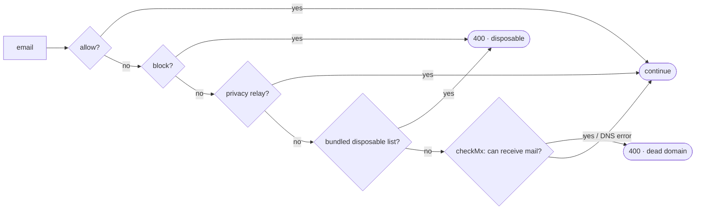

<div align="center">

<picture>
  <source media="(prefers-color-scheme: dark)" srcset="https://raw.githubusercontent.com/yasaiiko/better-auth-vetto/main/.github/banner-dark.svg">
  
</picture>

<br>

[](https://www.npmjs.com/package/better-auth-vetto)
[](https://www.npmjs.com/package/better-auth-vetto)
[](https://www.better-auth.com)
[](LICENSE)
[](src/index.ts)

**Stop throwaway inboxes at sign-up. Keep the privacy-conscious users.**

[Install](#install) · [Options](#options) · [How it decides](#how-it-decides) · [Limits](#what-it-doesnt-do) · [Full guide ↗](https://usevetto.com/block-disposable-emails-better-auth)

</div>

---

## Why

| | |
|---|---|
| **Offline** | ~9,900 disposable domains bundled from the CC0 [disposable-email-domains](https://github.com/disposable-email-domains/disposable-email-domains) list. No API key, no network call, subdomains included (`x.mailinator.com`). |
| **Relay-safe** | Apple Hide My Email, DuckDuckGo, Firefox Relay, SimpleLogin, Proton Pass, addy.io and 33mail reach a real inbox, so they get through unless you `block` them yourself. [Some popular lists block them](https://github.com/yasaiiko/disposable-list-audit). |
| **Dead domains** | Optional `checkMx` rejects domains that can't receive mail. DNS errors and timeouts let the signup through. |
| **Alias key** | `canonicalEmail()` folds `j.a.n.e+trial7@googlemail.com` → `jane@gmail.com`, so one inbox can't farm trials. |

## Install

```sh
npm install better-auth-vetto
```

```ts
import { betterAuth } from 'better-auth';
import { vetto } from 'better-auth-vetto';

export const auth = betterAuth({
  emailAndPassword: { enabled: true },
  plugins: [
    vetto({
      checkMx: true,                     // Node runtimes; skipped where node:dns is missing
      allow: ['partner-company.com'],    // always accepted
      block: ['some-new-throwaway.com'], // extra rejects
    }),
  ],
});
```

A blocked request returns **`400`** with a message ready to show next to the email field. It runs on sign-up, change-email, magic link and email OTP, before anything is saved.

## How it decides



## Options

| Option | Default | |
|---|---|---|
| `allow` | `[]` | Domains always accepted (checked first) |
| `block` | `[]` | Extra domains to reject |
| `allowRelays` | `true` | Let privacy relays through |
| `checkMx` | `false` | Reject domains that can't receive mail (fails open) |
| `mxTimeoutMs` | `1500` | DNS timeout for `checkMx` |
| `paths` | sign-up, change-email, magic-link, email-otp send | Endpoints the check runs on |
| `message` | "Please use a permanent email address…" | Error for disposable domains |
| `deadMessage` | "This email domain cannot receive mail…" | Error for dead domains |

<details>
<summary><b>Helpers</b> (usable without the plugin)</summary>

<br>

| Function | Returns |
|---|---|
| `checkEmail(email, options)` | `'ok'` · `'disposable'` · `'dead'` |
| `canonicalEmail(email)` | Uniqueness key: lowercase, no `+tag`, Gmail dots removed, googlemail → gmail |
| `emailDomain(email)` | The domain, lowercased |
| `domainAcceptsMail(domain)` | `true` if MX (not null MX) or A/AAAA; DNS errors count as `true` |

Store `canonicalEmail()` in a column with a unique index to stop one Gmail inbox from opening many accounts. Keep the original address for sending mail.

</details>

## What it doesn't do

- **Typos** (`jane@gmial.com`), **bots** and **signup bursts** need the form and a shared history. That's what the hosted [Vetto](https://usevetto.com) script adds; this plugin works on its own and doesn't depend on it.
- **No list is complete.** Add what you see with `block`, and update the package for the latest list:

```sh
npm run update-domains
```

## Used by

- [dartcade](https://github.com/W3D3/dartcade): sign-up and email change ([PR #423](https://github.com/W3D3/dartcade/pull/423))

Using it? Open a PR and add your project.

## More from Vetto

| | |
|---|---|
| [**disposable-list-audit**](https://github.com/yasaiiko/disposable-list-audit) | Weekly check of 7 popular blocklists for real providers and relays |
| [**supabase-vetto-hook**](https://github.com/yasaiiko/supabase-vetto-hook) | The same protection as a Supabase Auth hook |
| [**nextjs-vetto-example**](https://github.com/yasaiiko/nextjs-vetto-example) | Next.js form with browser + Server Action checks |
| [**Vetto MCP server**](https://usevetto.com/mcp-server) | Check signup emails from Claude, Cursor or ChatGPT |

## License

MIT. The bundled domain list is CC0 1.0, from [disposable-email-domains](https://github.com/disposable-email-domains/disposable-email-domains).
